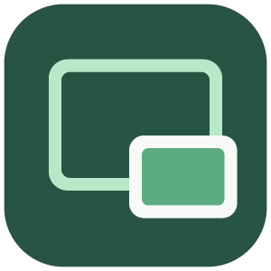
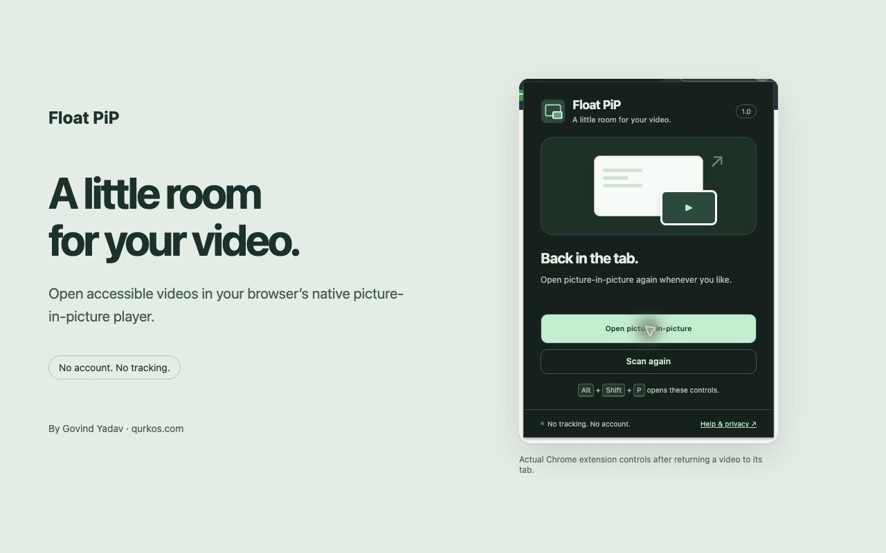

<p align="center"></p>

# Float PiP by Qurkos

**Keep your video nearby.** A small, privacy-focused picture-in-picture helper for desktop Chrome, Edge and Firefox, by [Govind Yadav](https://github.com/GtechGovind).

[](https://github.com/GtechGovind/float-pip/actions/workflows/ci.yml)
[](https://github.com/sponsors/GtechGovind)
[](LICENSE)

[Qurkos](https://qurkos.com/) · [Privacy policy](https://qurkos.com/float-pip/privacy/) · [Report a bug](https://github.com/GtechGovind/float-pip/issues/new/choose) · [Contribute](CONTRIBUTING.md) · [Support the project](SUPPORT.md)

## What it does

- Finds an accessible HTML5 video and opens the browser's native picture-in-picture player.
- Prefers the largest visible playing video and handles replacement players after activation.
- Offers an in-page button when the browser requires a direct click.
- Uses temporary `activeTab` and `scripting` permissions. No analytics, account, remote code, background worker or persistent host permissions.
- Includes guidance for Firefox's built-in PiP control when the standard API is unavailable.



## Install

As of November 17, 2026, Chrome, Edge and Firefox submissions are under review. Store approval and public availability are not yet confirmed. See [release status](docs/RELEASE-STATUS.md).

For testing, download the appropriate ZIP from [GitHub Releases](https://github.com/GtechGovind/float-pip/releases), or build it below. The GitHub packages are unsigned submission archives.

1. Extract the matching Chrome or Edge ZIP. Open `chrome://extensions` or `edge://extensions`, enable Developer mode, choose **Load unpacked**, and select the extracted directory containing `manifest.json`.
2. For Firefox, open `about:debugging#/runtime/this-firefox`, choose **Load Temporary Add-on**, and select `manifest.json` from the extracted Firefox package. Temporary installation lasts until restart. Permanent installation requires Mozilla signing.

Start a video, click **Float PiP**, then **Open picture-in-picture**. If the page button appears, close the popup and click it. Use the popup again to return the video. Keep the source tab open.

**Shortcut:** Alt + Shift + P opens the controls; Enter activates the focused button. If the shortcut conflicts, reassign it in the browser's extension shortcut settings.

## Build and test

Requires Python 3.9+ and Node 18+ for tests. The extension and packaging tool have no third-party runtime dependencies. No `npm install` is required.

```sh
git clone https://github.com/GtechGovind/float-pip.git
cd float-pip
node --test tests/*.test.cjs
python3 tools/build.py
python3 -m unittest discover -s tests -p 'test_*.py' -v
```

Generated packages, unpacked browser directories, source ZIP and SHA-256 checksums are in `dist/`. Load `dist/packages/chrome`, `dist/packages/edge`, or `dist/packages/firefox/manifest.json` for local development. Generated files are not committed.

The optional [browser smoke check](docs/TESTING.md) uses Playwright. It is separate from the dependency-free build and unit tests.

## Compatibility and limits

Chrome and Edge target desktop Chromium 102+. Firefox targets desktop Firefox 140+ and detects native PiP API support at runtime; where unavailable, use the guided built-in control. See [testing evidence and manual checklist](docs/TESTING.md).

The helper can inspect same-origin frames and open shadow roots. Cross-origin embeds, closed shadow roots, DRM, unsupported media and site/browser policies can prevent PiP. Captions and site overlays may remain in the original tab. Full navigation requires activating again; episode changes may require reopening PiP.

Native PiP was tested in Chrome with a generated video. Live Edge/Firefox playback and Netflix/Crunchyroll compatibility remain unverified. Float PiP does not bypass subscriptions, DRM or access restrictions, and is not affiliated with video platforms or browser vendors.

## Join in

Bug reports, browser compatibility reports, accessibility improvements, documentation and code contributions are welcome. Read [CONTRIBUTING.md](CONTRIBUTING.md) and our [Code of Conduct](CODE_OF_CONDUCT.md). Use [private security reporting](SECURITY.md) for vulnerabilities.

[Support and donations](SUPPORT.md) are optional. The code and original artwork are available under the [MIT license](LICENSE), copyright Govind Yadav.
